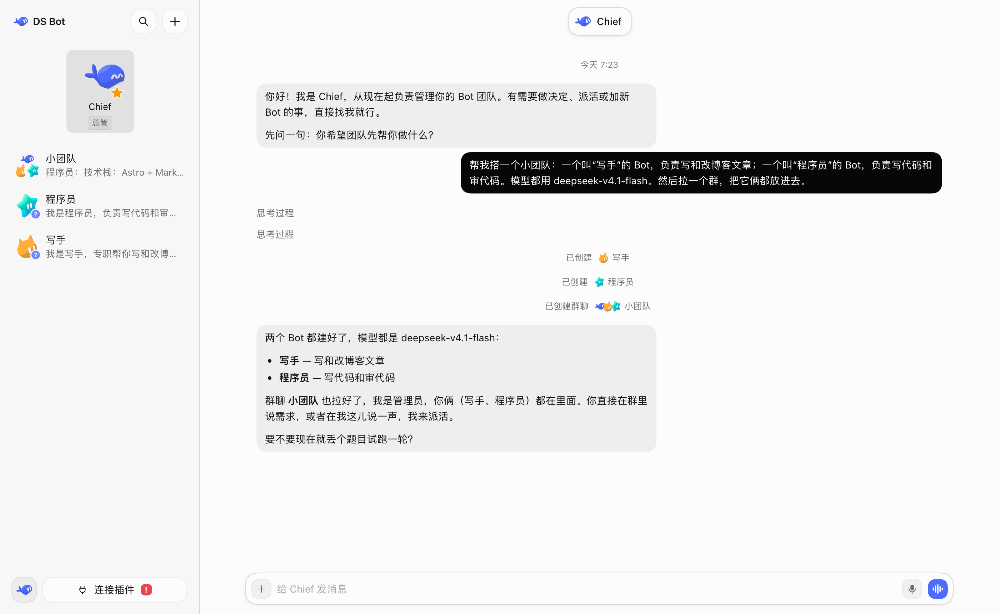
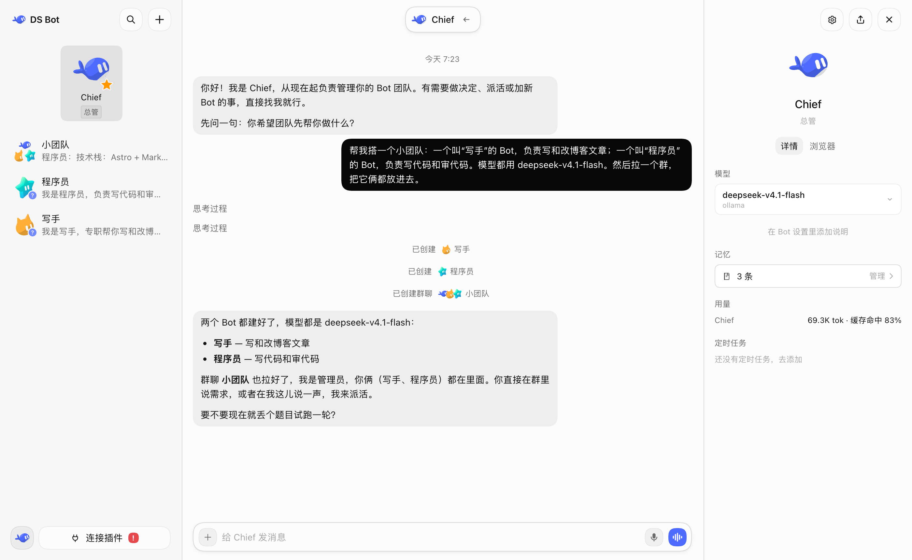
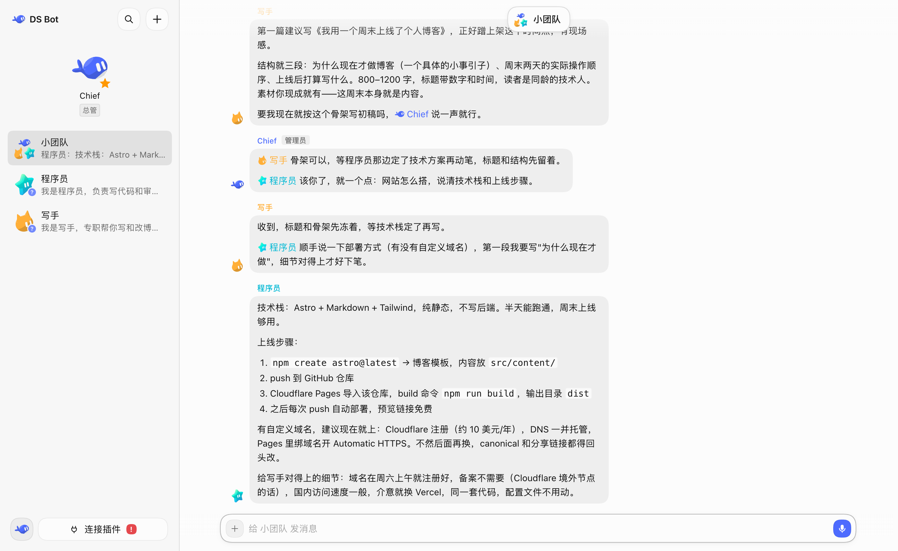
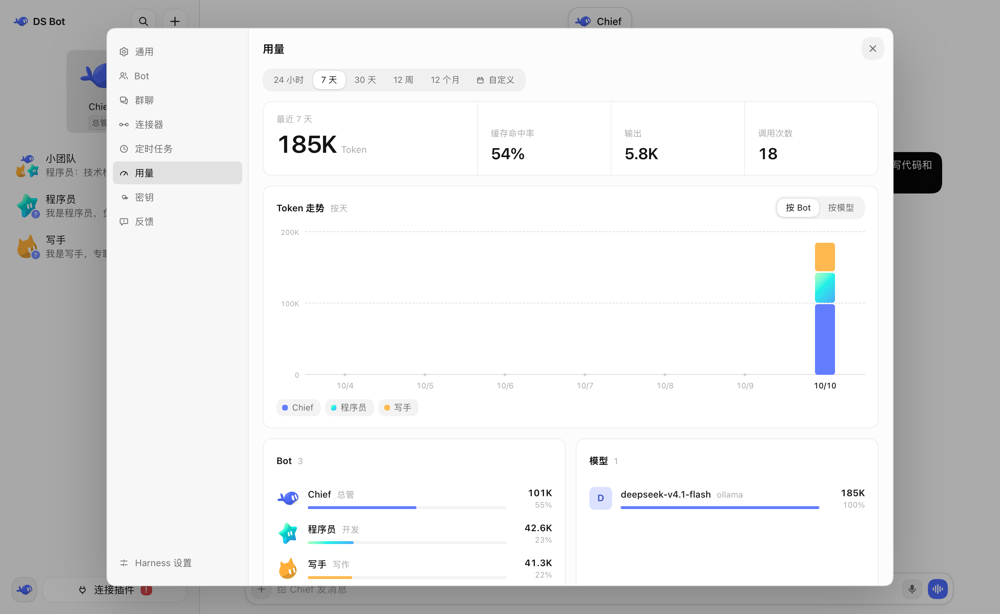

<picture><source media="(prefers-color-scheme: dark)" srcset="docs/images/logo-dark.svg"></picture>

# Cue

[English](README.md) | 中文

 

Cue 是一个开源的 bot 团队应用。你可以创建 bot，和它们对话、工作。Cue 使用 [Pi Durable](https://github.com/earendil-works/pi/tree/main/packages/durable) 运行。

## 安装

**桌面应用（Windows、macOS、Linux）**

桌面应用自带运行环境，不用先安装其他 Agent host。直接在 [Releases](https://github.com/Fei2411/DS-Bot/releases/latest) 下载对应系统的安装包，打开后在设置里配好模型就能用。

如果安装或打开时提示未签名拦截：Windows 点 **更多信息** → **仍要运行**；macOS 在 **系统设置** → **隐私与安全性** 里点 **仍要打开**。

**Docker（NAS、Linux 服务器）**

见 [`docker/README.md`](docker/README.md)。

## 配置

我强烈建议你直接通过和 bot 对话来配置其他 bot 和群聊。

### 网页搜索

Cue 会根据模型 provider 和你配置的 key 选择搜索路由。详见[网页搜索说明](ds-bot/README.md#web-search)。

## 功能

### Bot

你可以在一个窗口中和一个 bot 完成所有对话和工作，你无需担心背后的上下文问题。你可以在 bot 详情页查看 bot 信息，也可以为 bot 选择你想使用的模型和思考强度。你可以随时切换模型，但我仍然建议你为一个 bot 长期保持一个模型，仅在真正必要的时刻切换。

另外，bot 拥有记忆，它会记住你的喜好并在下次的工作中应用。你可以在 bot 的详情页管理记忆，也可以直接和 bot 对话来进行管理。

每个 bot 可以单独设置工作文件夹和权限，换文件夹直接和它说一声就行。它干活时你可以随时插话，或者输入 `/side` 开侧边对话顺手问一句而不打断它；它也能在回复里直接画图表、表格和表单，或者跑定时任务。侧边栏里还可以把 bot 和群聊按工作收进分组。

### Main bot

这个 bot 作为你的 chief，它拥有非常高的权限，可以管理其他 bot 和群聊。第一次进入 ds bot 时，默认会有一个 main bot 叫 Chief。你可以直接和它对话，让它引导你完成配置。

总之，有问题，找 main bot。

### 群聊

ds bot 拥有群聊功能。群聊是非常好的多 bot 协作方式，但它会带来非常明显的费用问题。ds bot 为此特意做了优化：在一个群聊中，你需要设置一个管理员。你的消息默认由管理员回复，它会帮你调用其他 bot。你也可以直接 @ 你需要沟通的 bot，它会直接回应你。想让 bot 参考另一段对话，点输入框的 + → 引用对话就行。

任何 bot 都可以用 @ 把活派给其他 bot，接活的 bot 自己去做，做完把结果发回群里。群聊有自己独立的记忆和工作文件夹，群外的 bot 看不到。做大任务时，群聊可以设定目标（Goal），由管理员先和你对齐完成标准，再拆成阶段分给成员，逐段验收推进。

### 隐私 bot

如果有些私密工作你只想和一个 bot 聊，可以在它的设置里打开隐私，并给它设一个独立的工作文件夹。其他 bot 读不到它的文件夹、记忆和聊天记录，它向其他 bot 发消息或写外部文件也必须先经你批准。就算删掉它，原来的内容也会继续受保护，直到你在设置里手动解除。

要注意，隐私 bot 不能作为 main bot，也不能进群聊。这道隔离只防团队里的其他 bot，不是系统沙箱：如果给了它终端命令或联网权限，它仍然能读写系统文件或联网，模型服务商也会收到对话内容。

### 本地 Agent

你电脑上已经在用的编程 Agent CLI（Claude Code、Codex CLI、Cursor CLI、Devin CLI、OpenCode、Gemini CLI 等）可以直接接入当 bot 用。新建 bot 时选本地 Agent（或在 bot 设置里切换），它就会直接用 CLI 自己的登录、套餐和模型，同时照常参与私聊、群聊、派活和记忆。

不过有几点限制：本地 Agent 走的是 CLI 自己的工具和上下文，ds bot 里的共享能力和连接器不会传给它，切换运行方式也会新开一段对话；不支持 HTTP MCP 的自定义 CLI 拿不到建 bot、派活等团队工具。另外，Cursor CLI 会把最后一次切换的模型存成它自己的全局默认（`~/.cursor`），如果你在 ds bot 里给某个 Cursor bot 选了具体模型，其他用默认模型的 Cursor bot 和你终端里的 Cursor 都会跟着变，不想改全局默认的话保持“CLI 默认”即可（需要先登录 Cursor 才能看到模型列表）。

### 浏览器

每个 bot 有自己独立的浏览器，登录状态互不干扰，也支持从文件或本机浏览器导入 Cookie。在 设置 → 浏览器 里开启操作插件后，bot 可以自己打开和操作网页；发帖、上传、下载、删除需要你批准，遇到登录、验证码或付款会发卡片交给你处理，你随时可以接管再交还。

浏览器功能仅桌面应用可用。退出后会保留网页登录状态，也支持导入 Cookie。Windows 上 Chrome 和 Edge 开启了 v20 加密的新 Cookie 无法直接读取，需要先用浏览器扩展导出成文件再导入。

### 电脑操控

在桌面应用的 设置 → 电脑操控 里打开开关后，bot 可以在你允许的范围内操作电脑上的应用。你可以给每个 bot 单独设档位（只看、后台操作、可以动前台）和允许使用的应用，操作时屏幕顶部有指示条，随时能暂停或接管；系统设置、密码管理这类应用永远不会交给 bot。

所有 bot 和你共用同一个桌面，同一个应用或前台鼠标同一时间只能有一个 bot 用。Windows 上 Chrome、Electron 这类应用在后台常收不到点击和输入，需要设为“可以动前台”，且无法操作管理员权限的应用；macOS 需要 14 及以上并开启辅助功能与屏幕录制权限；Linux 支持 X11，Wayland 受限。

### IM

在 设置 → IM 里，可以把 bot 或群聊连到微信、飞书、钉钉、企业微信、QQ、Telegram、Discord 或 Slack。配对账号后就能在聊天软件里直接对话、在群里 @ 机器人、回复提问卡和审批卡，电脑不需要公网地址或开放端口。

只有你的电脑开着、ds bot 在运行时才能收发消息。微信只支持和扫码账号私聊，不支持群聊；微信和 QQ 受平台限制，只有在你发消息后的一段时间内能回复，超时后你在聊天软件里再发一句就能恢复。微信、QQ、钉钉没有卡片按钮，直接回复数字编号来选择；出于安全，密钥卡不能在聊天软件里填。

### 连接器与能力

在 设置 → 连接器 里，可以登录 GitHub、Gmail、QQ 邮箱、163 等邮箱和远程 MCP 服务，也能从 Claude Desktop、Cursor、VS Code 导入已有配置。凭据保存在 ds bot 的密钥里，bot 看不到明文，写的邮件默认也要你确认后才发。

在 设置 → 能力 里，可以管理团队共享的 MCP 服务、技能和能力包，并在每个 bot 的设置里按需开启；bot 自己添加的本地命令需要先经你批准才能运行。

### Office 文件

bot 可以直接创建、检查和修改 Word（`.docx`）、PowerPoint（`.pptx`）和 Excel（`.xlsx`）文档，还能把页面渲染成图片来检查排版。桌面应用自带完整的运行环境。

### 用量

在 设置 → 用量 里，可以按时间、按 bot、按模型查看 Token 用量。

## 数据

所有数据都在你自己的电脑上，存在首次启动选定的位置（默认 `~/.cue`）。Docker 把同样的数据放在 `/data` 挂载里。卸载 Cue 不会删除这些数据。

## 开发

核心功能和自有 host 在 [`ds-bot/`](ds-bot/)。配置项和内部结构见 [`ds-bot/README.md`](ds-bot/README.md)，开发和测试方式见 [CONTRIBUTING.zh.md](CONTRIBUTING.zh.md)，版本变化见 [CHANGELOG.md](CHANGELOG.md)。

## 致谢

- [Pi Durable](https://github.com/earendil-works/pi/tree/main/packages/durable)：运行 Cue 里的持久对话和模型工具。
- [esbuild](https://esbuild.github.io/)：构建 Cue 的生成资源。
- 感谢下面这些项目公开的设计思路。ds bot 参考了它们的思路，没有使用它们的代码：
  - [AgentMemoryRepo](https://github.com/AgentMemoryRepo/agentmemoryrepo)：bot 记忆的 Markdown 格式。
  - [OpenAI Codex](https://github.com/openai/codex)：压缩时把用户原话留在摘要旁边，以及搜索聊天记录用的消息锚点。
  - [Hermes Agent](https://github.com/NousResearch/hermes-agent) 和 [Hermes Bot Mode](https://github.com/NousResearch/Hermes-Bot-Mode)：每个成员在每个群里一个会话，以及交接时带上用户之前的原话。
  - [OpenCode](https://github.com/sst/opencode)、[goose](https://github.com/block/goose)、[pi](https://github.com/badlogic/pi-mono)、[Gemini CLI](https://github.com/google-gemini/gemini-cli)：长对话什么时候压缩，交接笔记写哪些内容。
  - [obelisk](https://github.com/tommy0103/obelisk)：用 SQLite 全文索引搜索聊天记录。
- 每一位试用 ds bot、提问题、报 bug 的人。

## 许可

[Apache License 2.0](LICENSE)。按“原样”提供，不附带任何担保。用到的第三方代码和它的许可见 [NOTICE](NOTICE)。

## 声明

Cue 是独立的社区项目，不隶属于任何模型 provider，也没有获得它们的认可。DeepSeek 是 Cue 支持的模型 provider 之一。

bot 会消耗你自己的模型额度，也会按你的要求读写文件、运行命令。重要的操作请自己检查。
